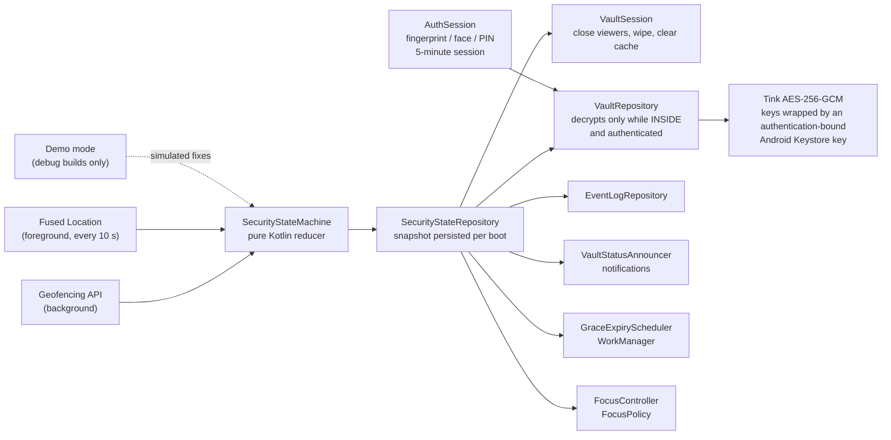

# SafeComp

SafeComp keeps company files in an encrypted vault on an employee's Android phone. The files can
only be opened while the phone is inside the office geofence **and** the owner has just confirmed
it's them with the phone's fingerprint, face or PIN. If the phone is lost or stolen, or someone
else is using it, the company data stays locked.

It is a working MVP built for a cybersecurity scholarship project: Kotlin, Jetpack Compose, one
activity, MVVM, minSdk 26, targetSdk 37.

## Threat model

**Protects against accidental exposure:**

- A lost or stolen phone: files are encrypted, and the keys only decrypt them inside the office.
- Someone else using the phone (a family member, a curious friend): outside the office they see
  a locked vault and a hedgehog, not file names.
- Shoulder-surfing and screen capture: screenshots, screen recording, casting and the
  recent-apps preview are blocked.
- Files lingering after you leave: crossing the boundary closes any open file and wipes it from
  memory.

**Deliberately not an employee-monitoring tool.** SafeComp never uploads anything (it has no
internet permission at all), never stores coordinates, and its log is for the employee's own
information. Location is reduced to "inside / outside the office" on the phone itself.

**Out of scope** (see [Limitations](#limitations)): a determined attacker with a rooted phone,
someone photographing the screen with another camera, and malware with system privileges.

## Architecture



- **One source of truth.** Every location signal becomes a `SecurityEvent`. A pure reducer
  (`SecurityStateMachine.reduce`) turns it into the new state, and listeners react: the vault,
  the log, notifications, the background timer and Focus Mode. No listener can change the state.
- **Pure logic, unit-tested.** The state machine, notification rules, event-log rules and Focus
  Mode rules have no Android dependencies. 91 unit tests cover them and the crypto.
- **MVVM with manual dependency injection.** Compose screens → ViewModels → repositories, wired
  in `AppContainer`. No DI framework: every dependency is visible in one file.

| Package | Responsibility |
|---|---|
| `security/` | State machine, persisted snapshot, listener dispatch |
| `location/` | Location checks, geofence registration, boot receiver, grace-expiry worker |
| `crypto/` | Keystore-backed Tink keysets, file and file-name ciphers |
| `vault/` | Import, storage, in-memory viewing (memfd, decrypting media source), lock reaction |
| `log/` | Local event log rules and storage |
| `focus/` | Focus Mode policy, controller, capability detection |
| `demo/` | Demo mode interface (implementation in `src/debug` only) |
| `ui/` | Compose screens, the "Midnight vault" design system |

## Security model

### 1. Always encrypted at rest; location gates decryption

Files are encrypted once, when they're imported, and stay encrypted on disk forever. Crossing
the boundary only changes whether SafeComp is *willing to decrypt into memory*.

*Why:* re-encrypting everything at every crossing would be slow and fragile. A phone dying
halfway through could leave plaintext behind. With this design no crash can leave a readable
file on disk.

### 2. Cryptography

| What | How |
|---|---|
| File contents | Tink `StreamingAead`, AES-256-GCM-HKDF with 1 MB segments: large videos stream, and video can seek without decrypting everything before it |
| File names | Tink `Aead`, AES-256-GCM. A name like "Q3_layoffs.pdf" is sensitive too |
| Binding | Each file's random ID is the *associated data*, so swapping two ciphertext files is detected |
| Keys | Tink keysets generated on the phone and wrapped by a non-exportable AES key in the **Android Keystore** (hardware-backed where available). Since Phase 7 that key **requires user authentication**: see below. No hardcoded keys |
| Keys in memory | The unwrapped keysets exist only during an unlock session, and are dropped on background, screen-off, leaving the office, or after 5 minutes |
| Fail closed | If the Keystore can't use the key (not authenticated, or destroyed), nothing decrypts |
| Storage | `noBackupFilesDir/vault/<id>.bin`: app-private and excluded from every backup. Writes go to a temp file and are atomically renamed |
| Reset | Deletes every file and row, then destroys the keys (crypto-shredding): leftovers can't be decrypted |

### 2a. Who you are: fingerprint, face or PIN (Phase 7)

Location answers "where are you?". Phase 7 adds "who are you?": even inside the office, the vault
opens only after the owner confirms it's them with Android's own prompt. SafeComp has **no
password of its own** and never sees the PIN or the fingerprint; Android checks them.

| Rule | How it's enforced |
|---|---|
| The key that wraps the vault keys works only within **5 minutes** of a strong fingerprint/face or the phone's PIN, pattern or password | **Hardware** (Android Keystore, `setUserAuthenticationParameters`) |
| SafeComp asks again when it goes to the background, the screen turns off, or the phone leaves the office | **App** (`AuthSession` ends the session and drops the keys from memory) |
| No screen lock set: the vault stays locked, and onboarding explains why | Hardware (the key can't exist without one) and app |
| The screen lock is removed: Android **destroys** the key, so the files become unreadable and must be re-imported from the company source | **Hardware** |
| A fingerprint is added: the next unlock must use the **PIN**, then the new fingerprint set is trusted. Files are kept | App, detected with a fingerprint-only "check key" that Android destroys on enrolment |
| Changing any setting (office, timings, Focus Mode work apps, and later the schedule and zones) and Reset need the same authentication | App (screens prompt; the view models refuse without a fresh session) |

**Design decisions to defend:**
- **Why a 5-minute window and not a prompt for every file?** Android's per-use keys can't accept
  the PIN on Android 8–10 and can't be shared across several file reads. A short hardware window,
  plus the app ending the session early, gives the same protection with usable flows.
- **Why a new fingerprint doesn't wipe the files.** Android only destroys keys on fingerprint
  changes when they are fingerprint-only and per-use, which would remove the PIN fallback. And
  wiping would add no security: the threat is "someone who knows the PIN enrolls their own
  finger", but that person can already unlock with the PIN. So SafeComp requires the PIN once.
- **Why removing the screen lock does destroy the files.** Without a screen lock there is no
  owner to check. This is safer, at the cost of re-importing from the company source.
- **Honest note:** the hardware window counts any authentication to the phone, including
  unlocking the lock screen. SafeComp's own prompt and the "PIN after a fingerprint change" rule
  are enforced by the app.
- **Reset without a screen lock** is allowed: the keys are already gone (or never existed), so
  Reset only deletes unreadable data, and requiring an impossible authentication would leave the
  owner stuck. With a screen lock, Reset needs authentication.
- **Upgrading old installs:** the first unlock after the update reads the vault keys with the
  old key, stores them under the new one, reads them back to check, and only then deletes the
  old copies. Same keys, so every file stays readable; a crash midway just retries.

### 3. The location gate: INSIDE / OUTSIDE / UNKNOWN

Only **INSIDE** allows decryption. **UNKNOWN is treated exactly like OUTSIDE**: if SafeComp
can't prove the phone is in the office, the vault stays locked.

| Situation | Result |
|---|---|
| App start, office changed, new boot | UNKNOWN until a fresh fix confirms the position |
| Inside fixes or a geofence DWELL for the **dwell time** (default 30 s, 10–120 s) | INSIDE |
| Outside evidence while INSIDE | **Grace period** (default 60 s, 15–300 s), then OUTSIDE. Back inside during grace cancels it |
| Poor accuracy (worse than the radius) or no fix while INSIDE | Grace period, then UNKNOWN: GPS noise at the edge shouldn't flicker the vault |
| Location switched off, permission revoked, mock location, office not set | **UNKNOWN immediately**, no grace |
| INSIDE older than 2 minutes when the app reopens | Re-checked with a fresh fix |

Design details:

- **Radius of at least 100 m** (up to 1000 m), enforced in the UI and the data layer. Phone GPS
  is often off by 20–50 m.
- **Monotonic clock** (`SystemClock.elapsedRealtime`). Changing the date in Settings can't
  shorten or stretch the grace period. A clock that runs backwards locks.
- **Coordinates never enter the state machine**, only "distance to the office" and accuracy.
- **Two location sources.** Fused Location runs every 10 s while the app is open, and this is
  the real enforcement, because files can only be viewed in the app. The Geofencing API wakes
  the app in the background so lock notifications arrive on time.
- **A WorkManager job** ends the grace period even if the app was closed. Even if Android delays
  it, the next decryption request re-checks the time, so a late job can't extend access.
- **The office can only be edited while INSIDE** (or before it's set up). Otherwise whoever held
  the phone could move the "office" to where they're standing. Outside, the only option is
  Reset, which destroys everything.

### 4. Viewing without plaintext on disk

| Type | How it's shown |
|---|---|
| Images | Decrypted into a mutable bitmap, erased on close |
| Text | Decrypted into memory |
| PDF | Decrypted into an anonymous in-memory file (`memfd_create`, Android 11+) for `PdfRenderer`. Older versions show "unsupported" rather than write a temp file |
| Audio / video | Media3 ExoPlayer reading through a custom decrypting `DataSource`, with no disk cache |

### 5. Locking

When the state leaves INSIDE, or the app goes to the background, open viewers close and wipe
their buffers. On lock the cache directory is also cleared (defence in depth) and a "Vault
locked" notification is posted. Notifications never contain file names.

### 6. Screen protection

`FLAG_SECURE` is set on the window before the first frame and never removed. Dialogs and
pop-ups set it on their own windows. Screenshots and recordings come out black, and the
recent-apps thumbnail is blank (`setRecentsScreenshotEnabled(false)` on Android 13+).

### 7. Privacy by design

- **No `INTERNET` permission.** It's removed in the manifest even if a library asks for it.
  Backups and device transfers are disabled.
- **The event log** records state changes, every file-open attempt (allowed or blocked) and Focus
  Mode starting or stopping. It never records coordinates or which apps were used. It is kept
  14 days (at most 2,000 entries). File names appear only while INSIDE. It can only be cleared
  while INSIDE, so someone holding the phone outside can't erase blocked attempts.

## Why SafeComp only protects imported files (scoped storage)

Android sandboxes every app. Since Android 10, *scoped storage* deliberately stops apps from
reading or changing other apps' files and most of shared storage. SafeComp therefore can't
reach into Downloads, email attachments or another app's folder and lock files there, and it
shouldn't be able to: that power is exactly what malware wants.

So SafeComp protects what you **import** through the system file picker (the Storage Access
Framework). The picker gives SafeComp access to exactly the files you choose. After encrypting
them, SafeComp offers to delete the originals (`DocumentsContract.deleteDocument`) when the
storage provider allows it.

## Focus Mode (Phase 8)

While the employee is inside the office, Focus Mode can limit the phone to work apps using
Android's Lock Task Mode. It is the **opt-in, consent-based first step** towards an enterprise
feature, and the employee always keeps final control.

**What it does:**

- It is tied to the same state machine. **Only INSIDE allows Focus Mode**, and OUTSIDE or UNKNOWN
  always ends it. During the grace period the state is still INSIDE, so Focus Mode ends exactly
  when the vault locks.
- It starts automatically on arrival (switchable off in settings), with a dismissible
  notification that has a **Stop** button.
- Android only lets the visible app start Lock Task. If the employee arrives while SafeComp is
  closed, it posts an offer notification instead of launching itself.
- **The employee can always leave:** the Stop button in SafeComp, Stop on the notification,
  Android's unpin gesture, or the settings switch. After a manual stop or a "No thanks", it
  doesn't start again by itself until the phone has been seen outside the office (or the next
  day). The answer is saved, so it holds even after Android stops SafeComp in the background.
- **Work apps** are chosen in settings and stored in Room. SafeComp is always on the list, so
  Stop is always reachable. The picker sees only apps with a home-screen icon (a narrow
  `<queries>` entry, not `QUERY_ALL_PACKAGES`). The log records that Focus Mode started or
  ended and why, never which apps were used.

**What Android allows, detected at runtime and shown on screen:**

| Phone | What Focus Mode does | App allow-list |
|---|---|---|
| Normal, un-enrolled phone | **Screen pinning.** Android asks "Pin SafeComp?" and only SafeComp stays on screen | Not enforceable: pinning covers one app |
| Company-managed phone where a Device Policy Controller allow-listed SafeComp | Lock Task with no prompt | The **admin's** list |
| Debug build made a test device owner with adb (emulator demo) | Lock Task with no prompt | **The employee's chosen work apps** |

The rules live in `FocusPolicy`, a pure function with its own unit tests. It reads the security
state and never changes it, so a Focus Mode bug can't weaken vault locking.

### The honest limitation

On an un-enrolled phone, **the user controls Focus Mode and can always exit it**. Nobody,
including an admin, can enforce it. That is intentional: without enrollment, anything that
couldn't be exited would be trapping the user, not protecting them.

The full enterprise version needs:

1. **Android Enterprise** with **device enrollment** (a company-owned, fully managed phone, or a
   work profile).
2. A **Device Policy Controller** that sets the Lock Task allow-list and features.
3. A **policy server** that decides which apps are allowed and pushes that policy to phones.

This phase deliberately stops at the opt-in first step on that path.

**Demonstrating the real allow-list** on an emulator with no accounts (debug builds only):

```sh
adb shell dpm set-device-owner com.safecomp/.focus.FocusAdminReceiver
```

Then choose work apps in Focus Mode settings. Use **Remove test device owner** in the same
screen before uninstalling. The receiver exists only in `src/debug`: release builds contain no
device-admin component, so they can't be made a device owner.

## Demo mode (debug builds only)

Indoors, GPS is unreliable, so debug builds can simulate being inside or outside the office.
Simulated fixes go through the real state machine, so the dwell time, grace period,
notifications and log all behave as they would for real. A **DEMO MODE** badge is on every
screen, notifications say "(demo)", and log entries are tagged.

The implementation is in the `src/debug` source set. Release builds get a stub that can't be
switched on, plus a `BuildConfig.DEBUG` check in the repository as a second barrier.

## Limitations

- **Location can be spoofed on rooted phones.** SafeComp rejects mock locations
  (`Location.isMock`), but root tools can hide them. A future server-side check would close
  this gap (see below).
- **The screen can be photographed** with another camera, and on a rooted phone `FLAG_SECURE`
  can be bypassed. Screen protection is a mitigation, not a guarantee.
- **Keys are device-only.** The office rule is enforced by the app on the phone. Someone who can
  run code inside SafeComp's process on an unlocked phone, within 5 minutes of the owner
  authenticating, could ask the Keystore to decrypt.
- **A new fingerprint doesn't destroy the keys** (only a PIN is required once), and the
  5-minute hardware window also counts the lock-screen unlock. See "Who you are" above.
- **Memory wiping is best-effort.** Buffers SafeComp owns are zeroed, but the JVM's garbage
  collector may already have copied data.
- **Background geofence events can be late.** Android batches them to save battery, so a "Vault
  locked" notification can arrive minutes after leaving. Some brands (Xiaomi, Samsung, Huawei,
  Oppo…) also pause background apps, so onboarding asks to exclude SafeComp from battery
  optimisation and shows brand-specific steps. That uses the
  `REQUEST_IGNORE_BATTERY_OPTIMIZATIONS` dialog, which Google Play limits to certain app
  types; a Play build would open the battery settings page instead. Access is still enforced on time,
  because opening a file always re-checks the state.
- **Focus Mode can't be enforced** on an un-enrolled phone (see above).

## Future work

- **Server-side key release:** keep a key share on a company server that is released only
  after an attested "in office" check (for example over office Wi-Fi with Play Integrity). A
  rooted phone could then no longer unlock offline.
- **Data classification labels:** Public / Internal / Confidential, with stricter rules for
  higher labels (for example a shorter grace period, or Confidential files that open only while
  Focus Mode is on).
- **Controlled sharing** between employees: re-encrypting a file for a colleague's key without
  ever writing plaintext.
- **Enterprise Focus Mode:** the enrolled version described above.

## Building

1. Install [Android Studio](https://developer.android.com/studio) (it includes the JDK and Android SDK).
2. Open this folder in Android Studio and let Gradle sync.
3. Connect your phone with USB debugging on, then press **Run**.

From the terminal (after Android Studio is installed):

```sh
export JAVA_HOME="/Applications/Android Studio.app/Contents/jbr/Contents/Home"
./gradlew assembleDebug testDebugUnitTest
```

The Gradle wrapper jar was checked against Gradle's published SHA-256, and
`gradle-wrapper.properties` pins the distribution's checksum, so a tampered Gradle download
is rejected.

## Status

- [x] Phase 1: project setup, permission onboarding, screen-capture protection (`FLAG_SECURE`)
- [x] Phase 2: geofence setup and the INSIDE / OUTSIDE / UNKNOWN state
- [x] Phase 3: encrypted vault
- [x] Phase 4: boundary behaviour (grace period, auto-close, notifications)
- [x] Phase 5: local event log
- [x] Phase 6: demo mode (debug builds only)
- [x] Phase 7: fingerprint / face / PIN unlock and protected settings
- [x] Phase 8: Focus Mode (opt-in app restriction tied to the geofence)
